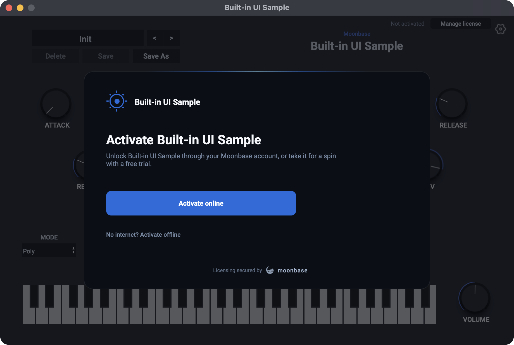
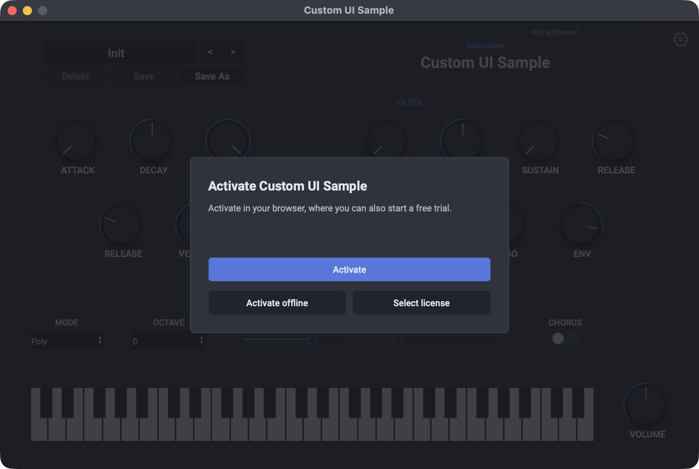

# Moonbase.sh Gorilla Engine Sample Plugins

These plugins show two ways to integrate Moonbase.sh for licensing into a [Gorilla Engine](https://www.gorilla-engine.com) plugin.
Both are the basic synth generated by [`create-gorilla-engine-plugin`](https://www.npmjs.com/package/@gorilla-engine-sdk/create-gorilla-engine-plugin), check the license in the plugin's own JavaScript, keep MIDI and audio off until the plugin has a license or a trial, and are wired to Moonbase's public demo store (`demo.moonbase.sh`, product `demo-app`), so they activate out of the box.

| Example | Package | Pick it when |
| --- | --- | --- |
| [Built-in UI](#built-in-ui-moonbaseshgorilla-engine) | [`@moonbase.sh/gorilla-engine`](https://www.npmjs.com/package/@moonbase.sh/gorilla-engine) | You want a finished activation overlay: online and offline activation, trials, license details, deactivation, add-ons and updates, drawn with Gorilla Engine's own controls |
| [Custom UI](#custom-ui-moonbaseshlicensing) | [`@moonbase.sh/licensing`](https://www.npmjs.com/package/@moonbase.sh/licensing) | You want to design the activation screens yourself, and drive the SDK directly |

Each example is a standalone Gorilla Engine project, so you can copy either folder to start your own.

## Getting started

You need [Node.js](https://nodejs.org/en/download/) and the Gorilla Engine SDK 26.10 or later, with a [gorilla-engine.com](https://www.gorilla-engine.com) account. Pick an example, then build, install and start it:

```bash
cd built-in-ui # or custom-ui
npm install
npm run buildAndInstall
npm start
```

`npm run buildAndInstall` compiles the plugin in Gorilla Engine's cloud and installs it, which takes a few minutes and asks for your gorilla-engine.com credentials the first time.
`npm start` then opens the standalone plugin, and redeploys and restarts it whenever you save a change. The first time, it asks for your password to make the installed plugin's files writable.
For developing in a DAW, debugging, and the extra setup on Windows, see the [`create-gorilla-engine-plugin` readme](https://www.npmjs.com/package/@gorilla-engine-sdk/create-gorilla-engine-plugin).

## Keep MIDI and audio off until the license is checked

Both examples start the plugin with MIDI and audio off. JavaScript can't protect the moment before the plugin's script runs, so the project file does, with two settings in each `.ugep`:

```json
"pluginConfig": {
  "audioEnabledOnStartup": false,
  "midiEnabledOnStartup": false
}
```

The template turns MIDI and audio on as soon as the instrument has loaded. In these examples those lines are gone, and licensing turns them on instead, once the plugin has a license or a trial.

The `.ugep` also sets the plugin's version to 1.0.0. Gorilla Engine has no version of its own for JavaScript to read, so each example repeats it as `appVersion`, which is reported to Moonbase and checked against the versions a license covers.

## Built-in UI: `@moonbase.sh/gorilla-engine`



[`@moonbase.sh/gorilla-engine`](https://www.npmjs.com/package/@moonbase.sh/gorilla-engine) builds on the licensing SDK, and brings the same activation screens as Moonbase's JUCE module and Electron module, as a React component for Gorilla Engine React.
It validates the stored license at startup, comes up over the plugin whenever it has no license, turns MIDI and audio on and off with the license, and keeps watching the license while the plugin runs.

### Add the module

We ran `npm install --save @moonbase.sh/gorilla-engine`, and then created the [licensing.ts](./built-in-ui/src/licensing.ts) file to store the configuration in:

```ts
import { createMoonbase } from '@moonbase.sh/gorilla-engine';

// The license is kept in the manufacturer's folder for user data, where every
// instance of the plugin shares it, so neither needs setting here
const moonbase = createMoonbase({
  productId: 'demo-app',
  endpoint: 'https://demo.moonbase.sh',
  publicKey: `-----BEGIN RSA PUBLIC KEY-----
...
-----END RSA PUBLIC KEY-----`,

  // Gorilla Engine has no version of its own to read, so keep this in step
  // with pluginConfig.version in the .ugep file
  appVersion: '1.0.0',

  // The built-in activation overlay, which comes up whenever the plugin has no license
  ui: {
    // Draw the overlay with the plugin's own fonts, rather than the system's
    fonts: {
      regular: 'fonts/Roboto-Regular.otf',
      medium: 'fonts/Roboto-Medium.otf',
      semibold: 'fonts/Roboto-Bold.otf',
    },
  },
});

// Validate the stored license and keep watching it. MIDI and audio stay off
// until the plugin has a license or a trial, and go off again if it loses it.
moonbase.start();

export default moonbase;
```

The module is created once, at the top level of the script, and lives as long as the plugin instance.
Every instance of the plugin, in any number of hosts, shares the license, kept in `~/Library/Application Support/Moonbase/Built-in UI Sample/license.mb` on macOS and `%APPDATA%\Moonbase\Built-in UI Sample\license.mb` on Windows, so activating one unlocks the others within a few seconds.

The overlay can carry your brand: an accent colour, your logo, the features of your trial, and your own copy for every screen.
See [the activation UI options](https://www.npmjs.com/package/@moonbase.sh/electron#the-activation-ui), which the Gorilla Engine module shares with the Electron module.

### Render the overlay

[index.tsx](./built-in-ui/src/index.tsx) renders `MoonbaseActivation` last, so it lies over the rest of the plugin:

```tsx
GEReact.createUI(
  <React.StrictMode>
    <ErrorBoundary>
      {/* the plugin, as the template made it */}
    </ErrorBoundary>
    {/* Rendered last, so the activation overlay lies over the rest of the plugin */}
    <MoonbaseActivation moonbase={moonbase} width={PLUGIN_WIDTH} height={PLUGIN_HEIGHT} />
  </React.StrictMode>,
  PLUGIN_WIDTH,
  PLUGIN_HEIGHT,
);
```

While the plugin has no license, the overlay comes up by itself, covers the plugin, and can't be closed.

### Show the license in the plugin

[LicenseStatus.tsx](./built-in-ui/src/app/components/LicenseStatus.tsx) shows the license above the synth, and updates it whenever it changes. The **Manage license** button opens the built-in license details, where the customer can copy their license ID for support or deactivate this computer:

```tsx
const { license } = useMoonbaseState(moonbase);

// ...

<geButton text="Manage license" onClick={() => moonbase.present('license')} />
```

To gate features of your own, check `moonbase.isLicensed()`, or `moonbase.hasSubProduct(id)` for an add-on.

### Check the project

The module comes with a check for the things above: the startup settings, that `appVersion` matches the project's version, and that the fonts are among the plugin's assets. It only reads files, and shows any fix as a diff:

```bash
npx @moonbase.sh/gorilla-engine doctor
```

## Custom UI: `@moonbase.sh/licensing`



This example drives the licensing SDK directly, and draws an activation panel of its own over the plugin while it has no license.

### Add the Moonbase SDK

We ran `npm install --save @moonbase.sh/licensing`, and then created the [licensing.ts](./custom-ui/src/licensing.ts) file to store the configuration in.
It uses the SDK's `ActivationController`, the activation state machine underneath the Gorilla Engine module, which does the license life-cycle for you:

1. At startup it validates the stored license, online when that is due. A license that can't reach Moonbase keeps working for a grace period (7 days by default), so the plugin works offline.
2. It runs browser activation, polling until the customer has finished, and offline activation from a license file.
3. While the plugin runs, it keeps watching the license: one that expires or is revoked locks the plugin, and one that another instance activates or deactivates is picked up within a few seconds.

```ts
// Every instance of the plugin, in any number of hosts, shares the license in the
// manufacturer's folder for user data, so activating one unlocks the others
const userData =
  process.platform === 'win32'
    ? (process.env.APPDATA ?? path.join(os.homedir(), 'AppData', 'Roaming'))
    : path.join(os.homedir(), 'Library', 'Application Support');

const licensing = new ActivationController({
  productId: 'demo-app',
  endpoint: 'https://demo.moonbase.sh',
  publicKey: `-----BEGIN RSA PUBLIC KEY-----
...
-----END RSA PUBLIC KEY-----`,

  // Reported with every activation and validation, and checked against the
  // versions a license covers. Gorilla Engine has no version of its own to read,
  // so keep this in step with pluginConfig.version in the .ugep file.
  appVersion: '1.0.0',

  licenseFile: path.join(
    userData,
    GorillaEngine.getManufacturerName(),
    GorillaEngine.getPluginName(),
    'license.mb',
  ),

  // Activation is finished in the customer's browser
  openUrl: (url) => GorillaEngine.openURLinBrowser(url),

  // Named in the error messages the controller words for the customer
  productName: GorillaEngine.getPluginName(),
});
```

The same file turns MIDI and audio on while the plugin has a license or a trial, starts the controller, and has a small hook that keeps a component's state current:

```ts
let enabled: boolean | null = null;
licensing.subscribe((state) => {
  if (state.status === 'loading' || state.licensed === enabled) return;
  enabled = state.licensed;
  GorillaEngine.getPluginMM(enabled);
  GorillaEngine.getPluginAE(enabled);
});

licensing.start();
```

The controller is also how you gate features of your own: `licensing.isLicensed()`, or `licensing.hasSubProduct(id)` for an add-on.

### Build an activation panel

[LicenseActivation.tsx](./custom-ui/src/app/components/LicenseActivation.tsx) is rendered last in [index.tsx](./custom-ui/src/index.tsx), and covers the plugin while `state.licensed` is false. It says what `state.status` calls for:

| `status` | The panel shows |
| --- | --- |
| `loading` | That the license is being checked |
| `unlicensed` | **Activate**, **Activate offline** and **Select license**, and why the plugin was locked when `lockReason` says |
| `activating` | That activation finishes in the browser, with **Open the browser again** and **Cancel** |
| `trialExpired` | That the trial has ended, with the same buttons as `unlicensed` |
| `notCovered` | That the license doesn't cover this version, with **Upgrade** |

Activation is a single call. The controller opens the browser, and polls in the background until the customer has activated, when the panel goes away by itself:

```ts
await licensing.activate();
```

Moonbase offers multiple licensing flows, but this is the one we recommend: a browser opens on your store, where customers activate seamlessly with their account. Our experience tells us this is usually a one-click process if they have a license already, and otherwise they are free to start a time-limited trial if your Moonbase product is set up to allow that.

For customers without internet access, the panel also supports offline activation: the plugin saves a device token that the customer uploads to the customer portal, and then selects the license file they get back:

```ts
// Save the device token
const token = await licensing.deviceToken();
const [file] = await GorillaEngine.openFileChooser({ saveDialog: true, allowedExtensions: '*.dt' });
if (file) await fs.writeFile(file, token);

// Then activate with the license file they got back
const [licenseFile] = await GorillaEngine.openFileChooser({ allowedExtensions: '*.mb' });
if (licenseFile) await licensing.activateOffline(await fs.readFile(licenseFile, 'utf8'));
```

When a call fails, the controller also puts the reason in `state.error`, worded for the customer (for example that a license was revoked), and the panel shows it.

### Show the license in the plugin

[LicenseStatus.tsx](./custom-ui/src/app/components/LicenseStatus.tsx) shows the license above the synth, with a **Deactivate** button that frees this computer's seat and locks the plugin again:

```ts
await licensing.deactivate();
```

## Before you ship

* Use your own store: set `endpoint`, `productId` and `publicKey` to your product's, from the Moonbase app.
* Keep `appVersion` in step with `pluginConfig.version` in the `.ugep` whenever you release.
* The template turns on `experimentalDebuggerSupport` for development. Set it to `false` before you ship, as debugger access makes the plugin's JavaScript, and so its license check, easier to tamper with.

## Questions about these samples?

Please reach out to us through the support channel in the app or at developers@moonbase.sh!
